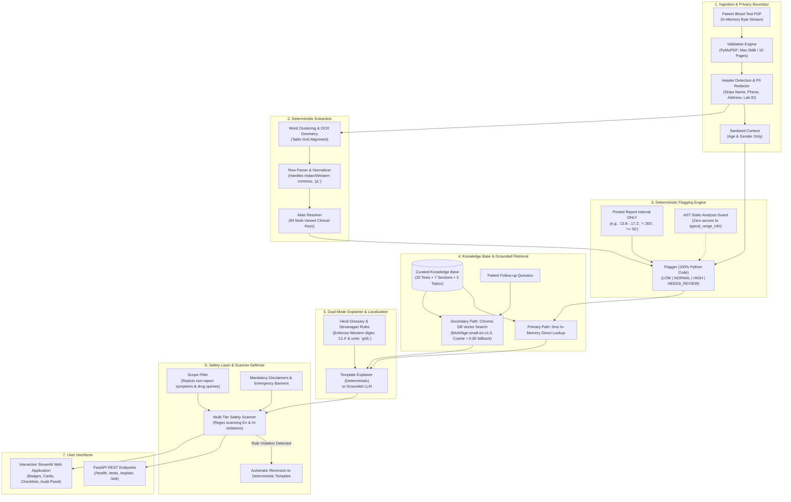

# AI Lab Report Explainer

[](https://www.python.org/downloads/)
[](https://fastapi.tiangolo.com/)
[](https://streamlit.io/)
[](https://opensource.org/licenses/MIT)
[](#safety--adversarial-defense)
[](#automated-testing)

An educational, non-diagnostic patient companion that ingests blood-test PDFs, deterministically extracts and flags test rows strictly against each report's printed reference intervals, and explains laboratory findings in plain English or Hindi using a curated, verified medical knowledge base.

---

## Architecture Overview



---

## Core Principles & Safety Boundaries

The system is built on eight non-negotiable principles to guarantee patient safety, privacy, and clinical accuracy:

| Principle | Implementation | Verification |
|---|---|---|
| **1. Code Decides, LLM Explains** | Extraction verification, range parsing, and flagging are 100% deterministic Python. An LLM never determines a flag. | 100% agreement across all 40 reports (818 rows). |
| **2. Range Ground Truth** | Flagger reads ONLY the reference range printed on the report. Knowledge base `typical_range_info` is purely informational and never used for flagging. | Enforced by AST static analysis test (`test_flagging_package_never_reads_typical_range_info`). |
| **3. Non-Diagnostic Safety** | Never diagnose conditions, prescribe medications or dosages, use false reassurance ("fine"), or alarmist words ("critical", "cancer"). | Compiled regex scanner checks every response in English and Hindi; 100% pass on 64 red-team attacks. |
| **4. Never Guess** | Corrupt, missing, or multi-tier ranges return `NEEDS_REVIEW` or `UNPARSED` with guidance to consult a doctor. | 100% rejection on out-of-bounds implausible clinical values. |
| **5. Grounding & Provenance** | The curated KB is the single source of truth. Every explained test carries verified provenance metadata and source links. | 100% of explained tests carry verified source citations. |
| **6. Privacy by Design** | PDF headers are stripped prior to downstream processing. All files are processed in-memory (`io.BytesIO`); zero PII persistence. | PII audit confirms 0 leaks of patient names, IDs, or contact info. |
| **7. Honest Evaluation** | Tuned exclusively on DEV split (12 reports); final benchmark run strictly once on untouched TEST split (28 reports). | All evaluation numbers logged transparently in [`METRICS.md`](METRICS.md). |
| **8. Preserved KB Integrity** | Source knowledge base JSON and CSV database are never silently modified. Human review items are tracked in [`docs/KB_OPEN_ITEMS.md`](docs/KB_OPEN_ITEMS.md). | Tracked gaps maintained for human review sign-off. |

---

## Key Features

- **Multi-Layout PDF Parser:** Extracts test tables across four distinct hospital report layouts:
  - *Layout A:* Standard single-page lab tables.
  - *Layout B:* Sectioned panels (CBC, Lipid Profile, Liver Panel) with printed H/L flag columns.
  - *Layout C:* High-density compact two-column formats.
  - *Layout D:* Complex multi-tier ranges, one-sided inequalities, and qualitative tests.
- **Micro Sign (`µ`) Fidelity:** Bundles Bitstream Vera TTF fonts (`Vera.ttf` / `VeraBd.ttf`) ensuring 100% accurate extraction of `cells/µL` across operating systems.
- **Dual-Mode Clinical Explainer:**
  - `kb_template`: 100% deterministic, instant in-memory rendering from curated medical text (0ms latency, 0 token costs).
  - `llm_grounded`: LLM-simplified explanations with strict grounding and automated fallback to `kb_template` if any safety rule is triggered.
- **Hindi Localization:** Complete Devanagari translation covering all 20 blood tests while strictly maintaining Western Arabic digits (`12.4`, not `१२.४`) and Latin scientific units (`g/dL`, `mg/dL`).
- **Informed Doctor Checklists:** Automatically generates targeted, contextual questions for patients to ask their healthcare provider during clinical visits.
- **Developer Inspection Panel:** Real-time visibility into OCR bounding boxes, extraction confidence scores, and pipeline audit traces.

---

## Evaluation & Benchmark Results

Tuned strictly on the DEV split (12 reports, 231 rows); evaluated once on the untouched TEST split (28 reports, 587 rows). Detailed breakdown available in [`METRICS.md`](METRICS.md) and [`docs/eval_results/summary.md`](docs/eval_results/summary.md).

### Untouched TEST Split Extraction (28 Reports, 587 Rows)
| Layout | Reports | GT Rows | Extracted Rows | Precision | Recall | Row F1 | Name Acc | Value Acc | Unit Acc | Range Acc | Unparsed | Wrong-Conf |
|---|---|---|---|---|---|---|---|---|---|---|---|---|
| **Layout A** | 7 | 150 | 150 | 1.0000 | 1.0000 | **1.0000** | 100.0% | 100.0% | 100.0% | 100.0% | 0.0% | 0.0% |
| **Layout B** | 7 | 147 | 147 | 1.0000 | 1.0000 | **1.0000** | 100.0% | 100.0% | 100.0% | 100.0% | 0.0% | 0.0% |
| **Layout C** | 7 | 155 | 155 | 1.0000 | 1.0000 | **1.0000** | 100.0% | 100.0% | 100.0% | 100.0% | 0.0% | 0.0% |
| **Layout D** | 7 | 135 | 135 | 1.0000 | 1.0000 | **1.0000** | 100.0% | 100.0% | 100.0% | 100.0% | 0.0% | 0.0% |
| **TOTAL** | **28** | **587** | **587** | **1.0000** | **1.0000** | **1.0000** | **100.0%** | **100.0%** | **100.0%** | **100.0%** | **0.0%** | **0.0%** |

### Flagging & Red-Team Defense
- **Deterministic Flagging Agreement:** **100.00%** (587 / 587 rows)
- **PII Leaks:** **0 leaks** detected across all rows and log files.
- **Adversarial Red-Team Pass Rate:** **100.0%** (64 / 64 attacks successfully blocked or safely handled).
- **Benign Educational Q&A Grounding:** **100.0%** (20 / 20 queries grounded with verified citations).

---

## Knowledge Base Open Items & Human Review

In accordance with Core Principle #8, unverified external clinical data is never silently modified. Open items are formally documented in [`docs/KB_OPEN_ITEMS.md`](docs/KB_OPEN_ITEMS.md):

| Item ID | Component | Description | System Handling | Status |
|---|---|---|---|---|
| **#1** | Total Bilirubin | Ambiguous sex-differentiated reference interval | Evaluated against report-printed range; flagged `NEEDS_REVIEW` if ambiguous. | Documented |
| **#2** | CSV Row 47 | Boundary test case tracking in lab database | Inclusive boundary rule verified; flags `NORMAL`. | Tracked |
| **#3** | Hindi Glossary | Clinical review required for Hindi translations | Clinical review packet generated in [`docs/hindi_review_packet.md`](docs/hindi_review_packet.md); disclaimer displayed in UI. | Awaiting Sign-off |

---

## Project Structure

```
AI Lab Report Explainer/
├── app/
│   └── streamlit_app.py              # Interactive Streamlit frontend UI
├── data/
│   ├── chroma/                       # Persistent Chroma DB vector index (145 chunks)
│   ├── eval/                         # Red-team (64 cases) & benign (20 cases) evaluation suites
│   ├── glossary/                     # Hindi Devanagari clinical glossary
│   ├── inputs/                       # Raw input CSV database & Knowledge Base JSON
│   └── synthetic/                    # 40 synthetic PDFs (12 DEV, 28 TEST) + Ground Truth JSONs
├── docs/
│   ├── eval_results/summary.md       # Full evaluation summary report
│   ├── hindi_review_packet.md        # Side-by-side Hindi clinical review packet
│   └── KB_OPEN_ITEMS.md              # Human review tracking document
├── scripts/
│   ├── demo_walkthrough.py           # End-to-end CLI demonstration walkthrough
│   ├── eval_kb_retrieval.py          # Vector retrieval evaluation script
│   └── eval_safety_and_explainer.py  # Safety scanner benchmark script
├── src/
│   ├── api/                          # FastAPI application & route handlers
│   ├── config.py                     # Centralized Pydantic application settings
│   ├── data/                         # Pydantic data schemas, loaders, and alias resolver
│   ├── explain/                      # Deterministic and LLM-grounded report explainers
│   ├── extraction/                   # PDF validation, table parser, and LLM fallback
│   ├── flagging/                     # Deterministic flagging engine & unit converter
│   ├── kb/                           # Knowledge base chunking, indexing, and vector retriever
│   ├── privacy/                      # Header boundary detector and PII redaction scanner
│   ├── safety/                       # Safety scanner regex rules, disclaimers, and scope filter
│   └── synthetic/                    # ReportLab synthetic PDF generator & font assets
├── tests/                            # 134 automated pytest verification tests
├── docker-compose.yml                # Docker Compose multi-service definition (API + UI)
├── Dockerfile                        # Multi-stage production container image
├── METRICS.md                        # Complete development & test evaluation logs
├── pytest.ini                        # Pytest configuration
├── requirements.txt                  # Pinned dependencies
└── README.md                         # Project documentation
```

---

## Quick Start & Setup

### Prerequisites
- Python 3.11.x
- Git

### 1. Local Environment Setup

```bash
# Clone repository
git clone https://github.com/Debanshu17/ai-lab-report-explainer.git
cd "ai-lab-report-explainer"

# Create and activate virtual environment
python -m venv venv
.\venv\Scripts\activate   # On Windows
# source venv/bin/activate  # On Linux / macOS

# Install dependencies
pip install --upgrade pip
pip install -r requirements.txt
```

### 2. Run the End-to-End Walkthrough Demo

To verify all components (ingestion, extraction, flagging, Hindi explanation, safety defense) in the terminal:

```bash
python scripts/demo_walkthrough.py
```

### 3. Start Web Services Locally

#### Terminal 1: FastAPI Backend
```bash
uvicorn src.api.main:app --host 127.0.0.1 --port 8000 --reload
```
*Interactive Swagger documentation available at: `http://localhost:8000/docs`*

#### Terminal 2: Streamlit Frontend
```bash
streamlit run app/streamlit_app.py --server.port 8501
```
*Open your browser at: `http://localhost:8501`*

---

## Docker Deployment

To launch both the FastAPI backend and Streamlit frontend in isolated containers:

```bash
docker compose up --build
```

- **Frontend Web UI:** `http://localhost:8501`
- **FastAPI Documentation:** `http://localhost:8000/docs`
- **Backend Health Check:** `http://localhost:8000/health`

---

## API Reference

### `GET /health`
Returns operational health status, active extraction mode, and LLM configuration.

### `GET /tests`
Lists all 20 supported clinical tests, canonical IDs, and recognized aliases.

### `POST /explain`
Upload a blood test PDF (`multipart/form-data`) and receive structured JSON extraction, deterministic flags, grounded explanations, doctor checklists, and provenance badges.

**Parameters:**
- `file`: PDF file bytes (max 5 MB, max 10 pages).
- `language`: `"en"` (default) or `"hi"` (Hindi).
- `mode`: `"kb_template"` (default) or `"llm_grounded"`.

### `POST /ask`
Submit a scoped follow-up question grounded in the patient's uploaded report tests. Non-report symptoms and medication requests are safely intercepted.

---

## Automated Testing

Execute the complete 134-item test suite across extraction, deterministic flagging, safety scanners, Hindi localization, and API endpoints:

```bash
pytest -v
```

All 134 tests run offline and execute in under 45 seconds.

---

## Medical Disclaimer

> **IMPORTANT:** This software is designed exclusively for educational and informational purposes. It is **NOT** a medical diagnostic tool and does not provide clinical diagnoses, treatments, or medical advice. Laboratory reference intervals vary between testing facilities and methodologies. Always consult a qualified medical professional for interpretation of laboratory test results.
